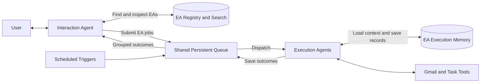

# OpenPoke: Controlling agent overload

An [OpenPoke](https://github.com/shlokkhemani/OpenPoke) fork that addresses **agent overload**. The **Interaction Agent (IA)** handles the conversation; saved **Execution Agents (EAs)** do the work. Each EA retains its identity, assigned work, state, and history across runs.

## Architecture and diagrams

| Diagram | What it explains |
| --- | --- |
| [Sequence diagram — Mermaid](https://mermaid.ai/d/d30bea16-7093-473f-971e-fea1f4a4dba9) | How requests move through agents, memory, and the queue. |
| [Solution board — Excalidraw](https://link.excalidraw.com/l/2C1urTzZVM0/2hmrnSZUcZZ) | Each problem, our change, and why it helps. |

Local copies: [Mermaid source](docs/diagrams/openpoke-overload-sequence.mmd), [editable Excalidraw board](docs/diagrams/openpoke-overload-solutions.excalidraw), and [board preview](docs/diagrams/openpoke-overload-solutions.png).

The architecture at a glance:

EA records, search data, execution memory, and the queue use SQLite. No separate vector database is needed.

## The problems, changes, and why

| Problem | What changed | Why it helps |
| --- | --- | --- |
| **IA context:** loading the full EA roster bloats its context window. | Use recent EA links or keyword + semantic search: **30 candidates per turn, 10 at a time**. Budget chat history. | Keep relevant context in the prompt; keep the directory in storage. |
| **EA history:** loading an EA's entire history bloats its context window. | Budget saved state, an earlier-work summary, and recent history. Retrieve exact source records on demand. | Keep each run's context manageable while preserving original details. |
| **Execution overload:** too many simultaneous EA runs overload resources. | Share one persistent queue across IA requests and Triggers: **100 running, 100 waiting, 1 running per EA**. | Allow independent tasks to run in parallel while bounding resource use and preventing concurrent updates to the same EA. |

## Keeping work consistent

- **Verify and reuse:** inspect the EA's stable ID and current record. Reject conflicting confirmed invoice/case IDs. Search active and archived EAs before creating another to keep related history together.
- **Recover safely:** a **300-second run deadline** frees stalled slots. Restart resumes unexpired queued jobs. Eligible interrupted read-only work allows one automatic retry per initiating request; interrupted writes or unknown tools require review.
- **Group outcomes:** return related results after submissions finish and every job has an outcome, including failures. Cap each initiating request at **5 follow-up stages and 20 job submissions**.
- **Archive safely:** archive eligible completed EAs after **30 inactive days**. Pending work, approvals, active Triggers, or unresolved execution issues prevent archival. Archived EAs stay searchable and reusable.

Limits are configurable defaults; token budgets are estimates with a safety margin. The implementation supports **one backend process**.

## Validation

All **196 automated pytest cases run offline**. Counts below group test files by their primary purpose; some checks also cover other solutions.

| Solution or supporting area | Test cases | What is checked |
| --- | ---: | --- |
| **IA context: bounded discovery and agent reuse** | **39** | Hybrid retrieval, candidate limits, identity conflicts and clarification. [Retrieval](tests/test_retrieval.py), [routing](tests/test_interaction_routing.py). |
| **EA history: bounded memory and source retrieval** | **13** | Token budgets, compaction, original-record preservation and history retrieval. [Budgets](tests/test_budgets.py), [registry/history](tests/test_registry_history.py). |
| **Execution overload: persistent queue and recovery** | **76** | Concurrency limits, per-agent serialization, ordering, timeouts, retries and uncertain actions. [Queue](tests/test_execution_queue.py), [execution runtime](tests/test_execution_runtime.py). |
| **Shared integration and approval safety** | **20** | Complete agent flows, exact draft presentation and approval preservation. [Integration](tests/test_runtime_integration.py), [draft presentation](tests/test_draft_presentation.py). |
| **Evaluation infrastructure** | **48** | Evaluation fixtures, scoring, spending limits, comparison and reporting. [Evaluation test inventory](tests/README.md). |
| **Total** | **196** | |

The evaluation suites define **114 cases/turns**: **60** original retrieval cases, **36** dense retrieval queries, **4** dense routing turns, **4** memory probes and **10** end-to-end workflow turns. These are suite-level cases, not 114 additional pytest tests. Upstream/fork comparisons and retrieval ablations reuse the same cases; scale benchmarks and simulated jobs are not counted as additional cases.

[Updated evaluation charts](docs/charts/README.md) show the three solutions, workflow success, retrieval quality, memory preservation and the token/latency tradeoff. The same page includes the original roster-growth, history-growth and queue-admission measurements.

Recorded checks, **November 16, 2026**:

- **196 automated tests passed.**
- The controlled real-model comparison passed **10/10 workflow turns in the fork versus 6/10 upstream**. The fork used **30.9% fewer chat prompt tokens**, with a higher median latency (**22.03 s versus 15.22 s**); the [results](docs/evaluation/README.md) explain the contract and individual failures.
- With real embeddings and **288 similar invoice agents**, hybrid retrieval found **34/34 targets at both @10 and @30**. Keyword-only found **24/34 at @10** and **34/34 at @30**; semantic-only matched hybrid in this corpus.
- Production IA routing over that dense corpus passed **3/3 owner selections and 1/1 clarification**. The saved original 3/4 score and disclosed numeric-format rescore to 4/4 are both visible.
- After real summaries of **72 exchanges**, **4/4 memory probes** passed exact fact, source citation and approval checks. All **215 source events** remained available.
- Candidate pools stayed at **30** with both **1,000 and 10,000 saved EAs**.

Automated tests and scale benchmarks use offline stand-ins. The dense retrieval, routing and memory checks use real models with synthetic email records.

[Recorded real-model results and limitations](docs/evaluation/README.md) preserve the original **10/10 and 9/10** workflow runs alongside the new results. The original unavailable-email failure exposed a false recovery lock that is now fixed and covered by regressions and the latest **10/10** live run. The [implementation rationale](docs/agent-optimization.md) explains retrieval alternatives, persistent queue tradeoffs and configurable limits.

These runs use real chat models and embeddings with synthetic email tools. See the [evaluation guide](tests/README.md#real-model-workflows) to reproduce them. Real Gmail workflows remain unvalidated.

## Run and explore

- [Local setup](docs/setup.md)
- [Tests and evaluation commands](tests/README.md)
- [Implementation details and configuration](docs/agent-optimization.md)

Built on OpenPoke. MIT license; see [LICENSE](LICENSE).
