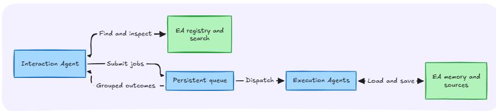
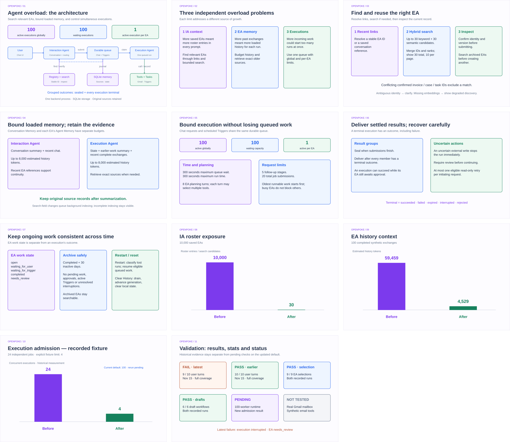

# OpenPoke: Controlling agent overload

An [OpenPoke](https://github.com/shlokkhemani/openpoke) fork that keeps growing agent workloads manageable. The **Interaction Agent (IA)** handles the conversation. Saved **Execution Agents (EAs)** own ongoing work; an **execution** is one queued run for an EA.

[Architecture](#architecture-and-diagrams) · [Changes](#the-problems-changes-and-why) · [Validation and stats](#validation) · [Run locally](docs/setup.md)

## Architecture and diagrams

[Editable presentation](https://link.excalidraw.com/l/2C1urTzZVM0/2hmrnSZUcZZ) · [Local Excalidraw presentation](docs/diagrams/openpoke-overload-solutions.excalidraw) · [Mermaid sequence](docs/diagrams/openpoke-overload-sequence.mmd)

View the full local presentation — 11 slides

EA records, keyword search (SQLite FTS5), embeddings, source history, and the queue live in SQLite. No separate vector database is needed.

## The problems, changes, and why

| Problem | What changed | Why it helps |
| --- | --- | --- |
| **IA context grows with the EA roster.** | Resolve recent EA links or combine keyword and semantic search. Show at most **30 candidates, 10 per page**; budget conversation history. | Keep discovery relevant as the number of saved EAs grows. |
| **EA context grows with execution history.** | Load state, an earlier-work summary, and recent complete exchanges within an **8,000 estimated-token history budget**. Retrieve exact sources on demand. | Preserve original records while keeping each run's loaded history bounded. |
| **Too many executions run at once.** | Share a persistent queue across chat and Triggers: **100 running, 100 waiting, one active execution per EA**. | Bound global work and serialize updates to each EA. |

## Keeping work consistent

- **Find and verify:** inspect the stable EA ID and current version before submission. Confirmed invoice/case/task ID conflicts rule out a match. Search active and archived records before creating another EA.
- **Save sources:** keep original records after summarization. Search-field changes queue background indexing; missing or failed indexing stays visibly degraded.
- **Bound each request:** allow **5 follow-up stages and 20 total submissions**. Each EA run allows **8 planning turns**, which may contain multiple tool calls.
- **Group outcomes:** workers may start before a group is sealed. Deliver its results only after sealing and every execution is terminal: `succeeded`, `failed`, `expired`, `interrupted`, or `rejected`.
- **Recover safely:** wait at most **300 seconds in the queue** and run at most **300 seconds**. Resume eligible queued work after restart. Allow one recorded, eligible read-only retry per initiating request. An uncertain external write stops the run immediately and requires review.
- **Archive completed work:** after **30 inactive days**, only when no work, approval, active Trigger, or unresolved interruption blocks it. Archived EAs remain searchable and reusable.

Limits are configurable; token counts are estimates with a safety margin. Run **one backend process**. Completing an execution does not necessarily complete its EA's ongoing work.

## Validation

[Results and status guide](docs/evaluation/README.md#validation-status) · [Scenario outcomes](docs/evaluation/README.md#scenario-outcomes) · [Before/after charts](docs/charts/README.md) · [Run checks](tests/README.md#run-checks)

| Status | Check | Recorded result | Evidence |
| --- | --- | --- | --- |
| **FAIL — latest full run** | Real models + synthetic email tools | **9/10** turns; **9/9** EA selections; **6/6** draft workflows | [Latest run, Nov 15](docs/evaluation/README.md#latest-full-run) |
| **PASS — earlier full run** | Same evaluated application and fixtures | **10/10** turns; **9/9** EA selections; **6/6** draft workflows | [Earlier run, Nov 15](docs/evaluation/README.md#earlier-full-run) |
| **PASS — historical** | Offline tests and retrieval | **129 tests**, **60/60** top-30 retrieval cases; candidate cap **30** at 1,000 and 10,000 EAs | [Offline evidence, Nov 14](docs/evaluation/README.md#offline-evidence) |
| **PENDING** | Updated **100-concurrent** configuration | Full runtime suite and admission measurement need a rerun on this revision | [Current revision](docs/evaluation/README.md#current-revision) |
| **NOT TESTED** | Real Gmail workflows | No recorded real-mailbox result | [Coverage limits](docs/evaluation/README.md#coverage-limits) |

The latest failure is the unavailable-email scenario: execution `interrupted`, EA `needs_review`; the scorer expected `succeeded` or `failed`. It reported the outage without inventing a due date or sending email. The failure remains visible.

Recorded results predate the 100-concurrent update. The saved concurrency chart uses a **four-worker fixture**; it is historical evidence, not a measurement of the new limit. Dates above use Toronto time.

## Run and explore

[Local setup](docs/setup.md) · [Test commands](tests/README.md) · [Implementation and settings](docs/agent-optimization.md) · [Local diagram guide](docs/diagrams/README.md)

Built on OpenPoke. MIT license; see [LICENSE](LICENSE).
