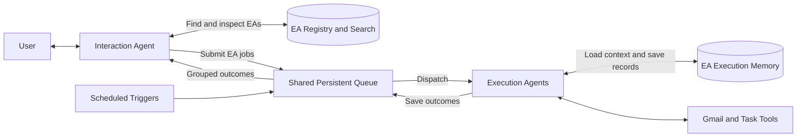

# OpenPoke: Controlling agent overload

An [OpenPoke](https://github.com/shlokkhemani/OpenPoke) fork that addresses **agent overload**. The **Interaction Agent (IA)** handles the conversation; saved **Execution Agents (EAs)** do the work. Each EA retains its identity, assigned work, state, and history across runs.

## Architecture and diagrams

| Diagram | What it explains |
| --- | --- |
| [Sequence diagram — Mermaid](https://mermaid.ai/d/d30bea16-7093-473f-971e-fea1f4a4dba9) | How requests move through agents, memory, and the queue. |
| [Solution board — Excalidraw](https://link.excalidraw.com/l/2C1urTzZVM0/2hmrnSZUcZZ) | Each problem, our change, and why it helps. |

Local copies: [Mermaid source](docs/diagrams/openpoke-overload-sequence.mmd), [editable Excalidraw board](docs/diagrams/openpoke-overload-solutions.excalidraw), and [board preview](docs/diagrams/openpoke-overload-solutions.png).

The architecture at a glance:

EA records, search data, execution memory, and the queue use SQLite. No separate vector database is needed.

## The problems, changes, and why

| Problem | What changed | Why it helps |
| --- | --- | --- |
| **IA context:** loading the full EA roster bloats its context window. | Use recent EA links or keyword + semantic search: **30 candidates per turn, 10 at a time**. Budget chat history. | Keep relevant context in the prompt; keep the directory in storage. |
| **EA history:** loading an EA's entire history bloats its context window. | Budget saved state, an earlier-work summary, and recent history. Retrieve exact source records on demand. | Keep each run's context manageable while preserving original details. |
| **Execution overload:** too many simultaneous EA runs overload resources. | Share one persistent queue across IA requests and Triggers: **4 running, 100 waiting, 1 running per EA**. | Bound resource use and prevent concurrent updates to the same EA. |

## Keeping work consistent

- **Verify and reuse:** inspect the EA's stable ID and current record. Reject conflicting confirmed invoice/case IDs. Search active and archived EAs before creating another to keep related history together.
- **Recover safely:** a **300-second run deadline** frees stalled slots. Restart resumes unexpired queued jobs. Eligible interrupted read-only work allows one automatic retry per initiating request; interrupted writes or unknown tools require review.
- **Group outcomes:** return related results after submissions finish and every job has an outcome, including failures. Cap each initiating request at **5 follow-up stages and 20 job submissions**.
- **Archive safely:** archive eligible completed EAs after **30 inactive days**. Pending work, approvals, active Triggers, or unresolved execution issues prevent archival. Archived EAs stay searchable and reusable.

Limits are configurable defaults; token budgets are estimates with a safety margin. The implementation supports **one backend process**.

## Validation

Recorded offline results, **November 14, 2026**:

- **129 automated tests passed.**
- Expected EAs appeared in the top 30 in **all 60 retrieval cases**, with no identity-conflict or ambiguity-guard failures.
- Candidate pools stayed at **30** with both **1,000 and 10,000 saved EAs**.

These checks use stand-ins for embeddings, model responses, and Gmail. Live EA selection and Gmail workflows still need end-to-end validation.

## Run and explore

- [Local setup](docs/setup.md)
- [Tests and evaluation commands](tests/README.md)
- [Implementation details and configuration](docs/agent-optimization.md)

Built on OpenPoke. MIT license; see [LICENSE](LICENSE).
