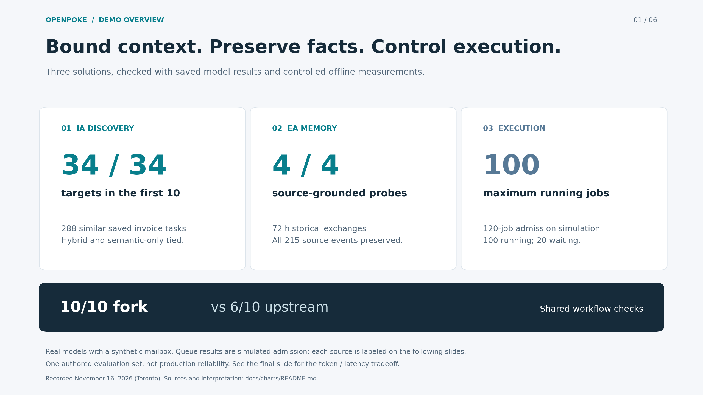
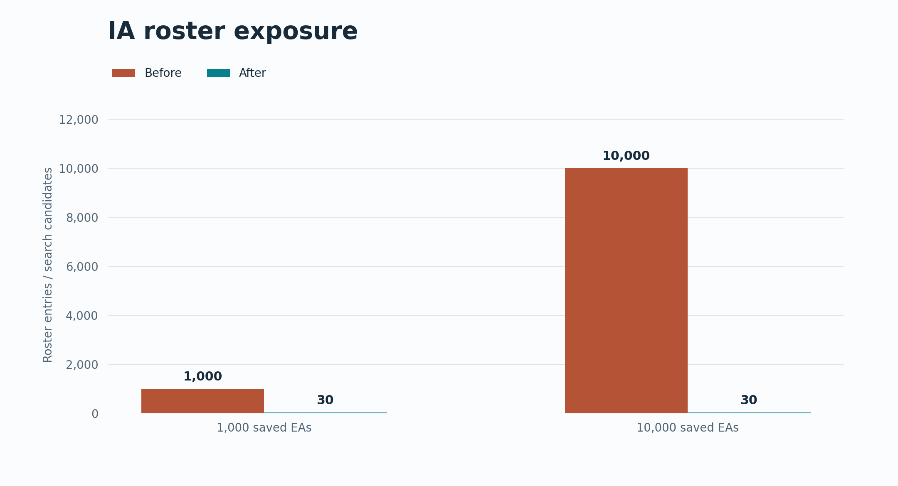
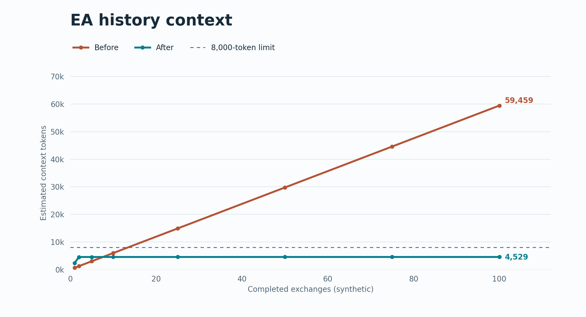
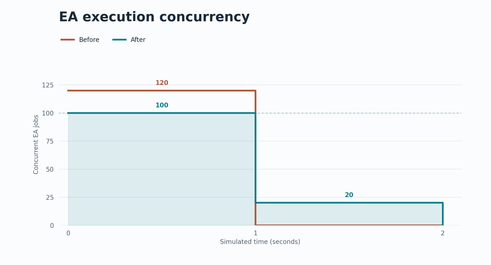

# Evaluation and overload charts

The updated images use the saved November 16, 2026 evaluation results. Each PNG is 2560 × 1440 and can be inserted directly into slides or shared from GitHub.

| Updated image | What it shows | Evidence |
| --- | --- | --- |
| [Solution overview](evaluation-overview.png) | Bounded discovery, source-grounded memory and controlled execution | [Evaluation results](../evaluation/README.md) |
| [Workflow success](workflow-success.png) | Fork 10/10 versus upstream 6/10 under the shared workflow contract, with individual outcomes | [Paired comparison](../evaluation/upstream-comparison.json) |
| [Retrieval quality](retrieval-quality.png) | Hybrid and semantic-only find 34/34 targets in the first 10; keyword-only finds 24/34 | [Dense retrieval](../evaluation/retrieval-hard-results.json) |
| [Memory preservation](memory-preservation.png) | 16,502 to 1,599 estimated context tokens, 215 source events retained and 4/4 source-assisted probes | [Memory evaluation](../evaluation/memory-results.json) |
| [Execution admission](execution-admission.png) | A simulated 120-job burst: 100 running, 20 waiting, all complete | [Admission measurements](measurements.json) |
| [Token and latency tradeoff](token-latency-tradeoff.png) | 30.9% fewer chat prompt tokens, with a higher median latency of 22.03 s versus 15.22 s | [Paired comparison](../evaluation/upstream-comparison.json) |



The comparison uses one authored ten-turn run with real models and synthetic email tools, not a production reliability estimate. Two upstream workflow failures occur after correct draft content; an IA-only text draft also fails the selected EA-owned persistence contract. Both implementations selected the correct existing owner in 8/8 applicable turns.

The retrieval corpus does not show hybrid outperforming semantic-only. Its dense workflow 4/4 result uses a disclosed numeric-format rescore; the original 3/4 is preserved. Memory checks require original-source retrieval and citations, so they do not measure summary-only recall. Context sizes are estimates, not total provider prompt tokens. The queue chart is an admission simulation, not live-model throughput. See the [full evaluation report](../evaluation/README.md) for scoring and limitations.

## Original overload measurements

The original three charts below explain resource growth and admission. They correspond to the three problems on the [Excalidraw board](https://link.excalidraw.com/l/2C1urTzZVM0/2hmrnSZUcZZ). PNG and SVG copies remain available below.

| Problem | Before | After | Evidence |
| --- | --- | --- | --- |
| IA roster exposure at 10,000 saved EAs | 10,000 roster entries | At most 30 search candidates, 10 per page | Upstream renderer + saved offline retrieval benchmark |
| EA history at 100 completed exchanges | 59,459 estimated context tokens | 4,529 estimated context tokens | Actual context builders on synthetic history |
| Simultaneous EA work in a 120-job burst | 120 running | At most 100 running; the rest wait | Source-derived upstream schedule + production queue admission replay |

## 1. IA roster exposure



**Explain it:** “As the number of saved EAs grows, the IA searches a bounded set of candidates instead of receiving the entire roster.”

The before values come from the unmodified upstream `_render_active_agents` function. The after values come from the existing offline benchmark: 12 repeats each at 1,000 and 10,000 agents. Counts compare roster entries with search candidates; they do not compare equal-sized records or total prompt tokens. Recent task links and other IA context are outside this chart. Search still scans more stored data at larger sizes; this chart makes no retrieval-speed claim.

[SVG](01-roster-context.svg)

## 2. EA history context



**Explain it:** “We retain the original records in storage while giving each run a bounded context, with exact source details available on demand.”

The same 100 synthetic invoice exchanges go through the upstream logger and the new journal. Each exchange contains one request, one tool call with a 60-line result, and one response. The upstream logger natively truncates tool results to 500 characters; that behavior is preserved. Its default context builder then loads all logged exchanges.

The new context builder includes task identity and the two most recent completed exchanges. This fixture generates no earlier-work summary and does not test summary quality. The [separate real-model memory evaluation](../evaluation/README.md) generates summaries and checks source-assisted exact recall after compaction. All 100 full tool results are verified to remain in the new journal. The 8,000-token line is the configured context budget; measured context need not fill it. Static system instructions and the next incoming request are excluded.

These are conservative character-based estimates with a 15% safety margin, using the application's offline fallback. They are not provider-reported tokens. A rerun with cached `cl100k_base` available will record that tokenizer and may produce different values. The fixture is an illustration of context growth, not a production token, cost, or accuracy estimate.

[SVG](02-history-context.svg)

## 3. Execution concurrency



**Explain it:** “Up to 100 independent EAs run together. Additional jobs wait, and each EA runs one job at a time.”

One hundred twenty independent requests, each for a distinct EA, arrive at simulated time zero. Each job lasts exactly one simulated second. The upstream trace is derived from its immediate-execution code. The after trace uses the production `submit` and `_claim_next` SQLite admission paths, with claims interleaved during arrival and simulated completions. All 120 jobs complete; peak admission is 100, with 20 initially waiting. Distinct requests avoid changing the default 20-submission limit per initiating request. Bursts of 100 or fewer independent jobs can all be admitted at once when capacity is free.

This is an admission simulation, not an end-to-end scheduler, live-model latency, or throughput benchmark. The 120-job burst finishes over two simulated seconds instead of one. Per-EA serialization, queue overflow, timeouts, and restart recovery belong to separate tests; an asynchronous scheduler test also checks 100 active EAs, a waiting 101st EA, and serialization of a follow-up for a busy EA.

[SVG](03-execution-concurrency.svg)

## Sources and reproduction

The baseline is upstream commit `5b5f635935a64ab37884c025d70abb0ed731c094`. [measurements.json](measurements.json) contains every plotted point, the saved retrieval benchmark excerpt, source hashes, and fixture details. It is safe to share: all fixture data is synthetic.

From the repository root, using the project Python environment:

```powershell
python tests/evaluation/measure_overload.py
python -m pip install matplotlib
python tests/evaluation/render_overload_charts.py
```

Measurement uses temporary SQLite databases and logs, with no model or Gmail calls. The saved retrieval report is used when available; otherwise the committed benchmark excerpt is reused. PNG and SVG files are regenerated from the JSON. These charts are separate from the real-model workflow evaluation and do not present its results as a before/after comparison.
