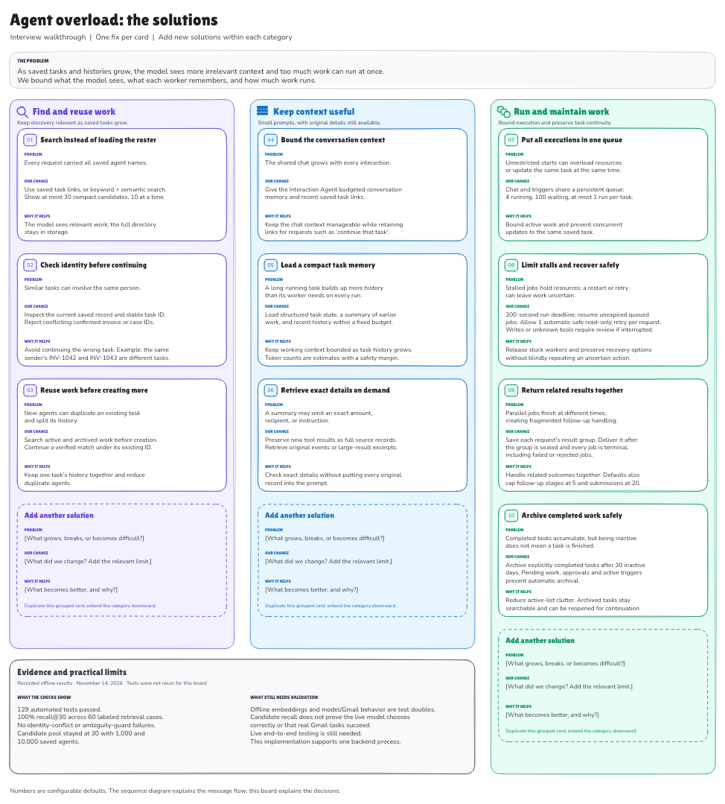

# Agent overload: solutions and sequence

## Solution board

[Open the editable Excalidraw board](https://app.excalidraw.com/s/2C1urTzZVM0/2hmrnSZUcZZ).

The board is designed for an interview walkthrough. Ten independent cards explain **the problem, our change, and why it helps**, including the relevant limits. They are grouped into three categories:

- **Find and reuse work:** bounded discovery, identity checks, and reuse before creation.
- **Keep context useful:** conversation budgets, compact task memory, and retrieval of original details.
- **Run and maintain work:** a shared queue, deadlines and recovery, grouped results, and safe archival.

Each category includes a grouped **Add another solution** template. Duplicate that card, edit its fields, and extend the category panel downward as needed. Cards are independent and have no flow arrows, so adding a solution does not require rewiring the board.

An invoice example illustrates task identity. A separate evidence box records the November 14, 2026 offline results and their limitations; the tests were not rerun to create this board. Numbers shown are configurable defaults, and the implementation supports one backend process.

- [Editable local Excalidraw file](openpoke-overload-solutions.excalidraw)
- [Card content and canvas source](openpoke-overload-solutions.source.json)

## Sequence diagram

The sequence diagram explains the message flow. The solution board explains the individual design decisions.

[Sequence source](openpoke-overload-sequence.mmd).
